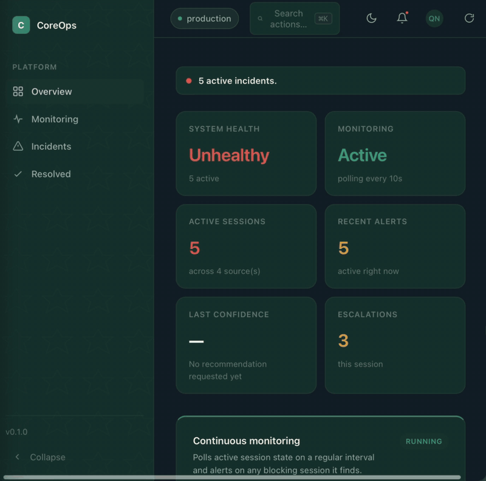
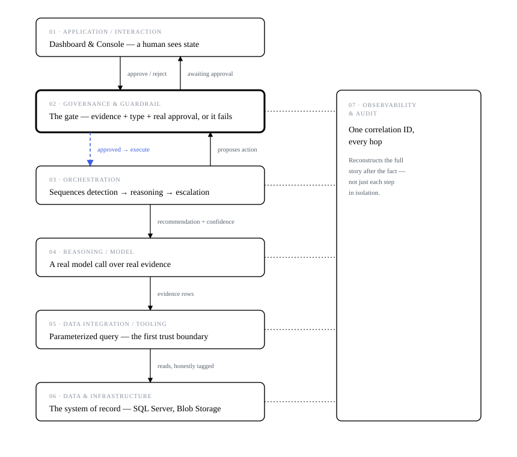
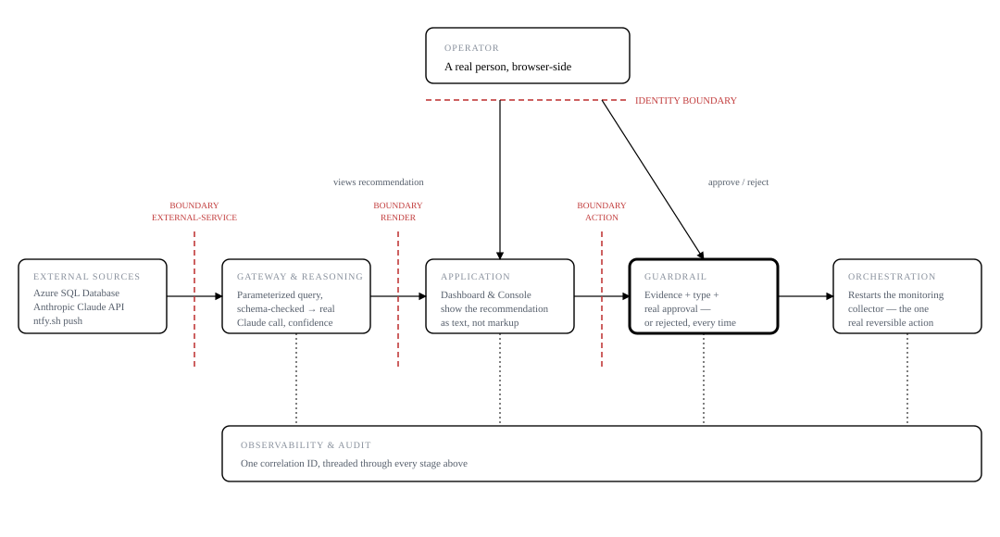

# CoreOps: AI operations with a human in control

An AI operations platform that finds the root cause of SQL Server and infrastructure incidents with Claude, and cannot change a production system until a verified human approves it.

[](https://github.com/qninying/ai-operations-center/actions/workflows/ci.yml)
[](https://github.com/qninying/ai-operations-center/actions/workflows/deploy.yml)
[](LICENSE)
[](mcp-server/package.json)

> - **What it is:** monitors SQL Server, SSIS, SSRS and Windows telemetry, correlates failures across systems, has Claude propose a root cause and a fix, and routes every fix through an MFA-verified human approval gate with a full audit trail.
> - **My role:** sole engineer: architecture, build, tests, deployment and operations.
> - **Stack:** TypeScript, Node 22, React + Vite, Claude API, Model Context Protocol (MCP), SQL Server, Postgres + pgvector, Docker, Fly.io, GitHub Actions.
> - **Headline results:** 541 automated tests · 16 architecture decision records · in production on Fly.io · deploy failure rolled back in about 90 seconds in a live drill.
> - **Live:** [coreops.fly.dev](https://coreops.fly.dev) · [Command Center](https://qninying.github.io/ai-operations-center/command-center/)

## Demo



Recorded on the production deployment: two services are down, the Postgres restart runs only after an approval and is confirmed healthy by a separate check, and the rejected Superset restart never runs. For incidents with evidence to analyse, Claude adds a root cause with cited evidence before the approval step.

Check the production deployment without logging in:

```bash
curl https://coreops.fly.dev/health/dependencies
```

It reports each data source's mode (`live` or `fallback`) and its last outcome. A source that is down shows as down, never as live.

## Key features

**Governance and security**
- Every production change needs an approval from the assigned, logged-in approver ([ADR-003](docs/ADR-003-session-based-authentication.md)).
- TOTP multi-factor login, built on `node:crypto` and checked against the RFC test vectors ([ADR-006](docs/ADR-006-totp-mfa.md)).
- Backup approver with its own identity takes over when an approval times out ([ADR-007](docs/ADR-007-second-approver-identity.md)).
- MCP gateway gives AI agents read-only diagnostics behind bearer-token auth ([ADR-001](docs/ADR-001-mcp-transport-selection.md), [ADR-014](docs/ADR-014-mcp-roots-containment-order.md)).

**AI reasoning**
- Root-cause agent grounded in DMV evidence; below 80% confidence it returns a differential instead of one guess.
- Every cited evidence ID, and every field and value behind a claim, is checked against the input ([ADR-008](docs/ADR-008-evidence-grounding-check.md), [ADR-009](docs/ADR-009-structured-claim-verification.md)).
- Near-duplicate incidents reuse a recent judgment via local embeddings and pgvector ([ADR-015](docs/ADR-015-triage-semantic-cache-pgvector.md)).
- Remediations follow DBA-style safety rules per source ([ADR-010](docs/ADR-010-sql-remediation-safety.md)).

**Reliability**
- Immutable audit trail, persisted and rotated, traceable by one correlation ID ([ADR-002](docs/ADR-002-audit-trail-correlation-id-unification.md), [ADR-005](docs/ADR-005-audit-trail-persistence.md)).
- Timeouts, capped retries and circuit breakers on every upstream call.
- Data sources are plug-in connectors with visible live/fallback status ([ADR-016](docs/ADR-016-plugin-connector-architecture.md)).
- Two execution paths act on real systems: Docker restart and Postgres blocking-query kill ([ADR-012](docs/ADR-012-real-docker-execution.md), [ADR-013](docs/ADR-013-real-postgres-remediation.md)).

**Operations and deployment**
- Dockerized, deployed to Fly.io by GitHub Actions, with automatic rollback and paging on failure ([runbook](docs/DEPLOYMENT.md)).
- Incident drill: broken health check caught by CI and rolled back in about 90 seconds ([write-up](docs/INCIDENT-DRILL-001.md)).

Full detail, with code paths and how each item was verified: [docs/FEATURES.md](docs/FEATURES.md).

## Architecture



Exactly one path can write to a monitored system, and only after a human approves a pending remediation. Collectors, AI agents and read paths have no write access at all.



| ADR | Decision |
|---|---|
| [001](docs/ADR-001-mcp-transport-selection.md) | MCP over StreamableHTTP for network callers, stdio for local use, bearer-token auth |
| [002](docs/ADR-002-audit-trail-correlation-id-unification.md) | One correlation ID shared by the audit log and operational logs |
| [003](docs/ADR-003-session-based-authentication.md) | Server-side sessions over JWT: no distributed system to benefit, and no token in `localStorage` |
| [004](docs/ADR-004-console-serving-topology.md) | Serve the built console from `mcp-server` on the same origin |
| [005](docs/ADR-005-audit-trail-persistence.md) | Append-only JSONL audit trail over SQLite, with size-based rotation, never deletion |
| [006](docs/ADR-006-totp-mfa.md) | TOTP MFA over emailed codes or WebAuthn; login itself requires it |
| [007](docs/ADR-007-second-approver-identity.md) | A dedicated backup approver identity over a general user store |
| [008](docs/ADR-008-evidence-grounding-check.md) | Citation-existence check over a second "critic" LLM call |
| [009](docs/ADR-009-structured-claim-verification.md) | Exact claim-to-field verification over fuzzy text similarity |
| [010](docs/ADR-010-sql-remediation-safety.md) | Source-aware remediation with DBA safety rules |
| [011](docs/ADR-011-moroccan-theme-system.md) | One shared day/night theme across all three UIs |
| [012](docs/ADR-012-real-docker-execution.md) | First real execution path: Docker restart, confirmed healthy before reported fixed |
| [013](docs/ADR-013-real-postgres-remediation.md) | Second real execution path: Postgres blocking-query kill |
| [014](docs/ADR-014-mcp-roots-containment-order.md) | Resolve the real path before checking MCP roots, closing symlink and `../` escapes |
| [015](docs/ADR-015-triage-semantic-cache-pgvector.md) | Local embeddings and pgvector over a paid embeddings API |
| [016](docs/ADR-016-plugin-connector-architecture.md) | Read-only connector registry over dynamic loading or a plugin framework |

The written architecture package (summary, layer diagrams, trust boundaries) is in [`project-blueprint/expo/`](project-blueprint/expo/).

## Quick start

Needs Node 22. No SQL Server, Azure or Anthropic account required: without them, data sources fall back to fixture data and say so.

```bash
git clone https://github.com/qninying/ai-operations-center.git
cd ai-operations-center/mcp-server
npm ci
{
  echo "AUTH_USERNAME=operator"
  echo "AUTH_PASSWORD_HASH=$(npm run --silent hash-password -- 'change-me')"
  npm run --silent generate-totp-secret | head -1
} > .env
npm run http
```

Open <http://localhost:8787/login> and sign in as `operator` / `change-me`. For the one-time code, add the TOTP secret from `.env` to an authenticator app, or run `npm run current-totp-code` in a second terminal.

Optional:
- **AI root-cause analysis:** add `ANTHROPIC_API_KEY=...` to `.env`. Every other setting is documented in [`.env.example`](mcp-server/.env.example).
- **Role-based Operations Console:** `npm run build-console && npm run http`, then open <http://localhost:8787/console?role=it-manager>.
- **MCP over HTTP for AI agents:** set `MCP_API_TOKEN` in `.env`, then `npm run http-mcp`.

## Testing

541 tests, counted from a full run on 2026-11-10 with Node 22:

| Package | Tests |
|---|---|
| `mcp-server/` | 465 |
| `guardrails/` | 70 |
| `frontend/` | 6 |

```bash
for d in mcp-server guardrails frontend; do (cd $d && npm ci && npm test); done
```

Type check: `npx tsc --noEmit` in `mcp-server/` and `guardrails/`, `npx tsc -b` in `frontend/`. Adversarial prompt-injection and jailbreak probes: `npm run eval:adversarial` in `mcp-server/` (calls the Claude API).

## My contribution and AI usage

- **What I designed and decided:** the architecture and its core rule, that only one path can write to production and only after an MFA-verified human approves. I made all 16 architecture decisions, including the alternatives I rejected, and owned deployment, the incident drill and production operations.
- **What I built myself vs. with AI assistance:** I used Claude Code as a pair programmer for most of the implementation and tests. I set the requirements, reviewed every change and decided what shipped.
- **How AI-written code was reviewed and verified:** nothing counted as done on the AI's word. Each change needed passing tests plus a check against the running system, recorded with its evidence in the progress log. Several "done" claims failed that check and were fixed, for example an approval check that compared a value against itself and could never fail.
- **What I would do differently:**
  - Set up CI and monitoring on day one. Full CI only arrived at the end, and a code review workflow failed silently for three months before I noticed. A check nobody watches is no check at all.
  - Check the hosting platform's limits before designing the deploy. I planned blue-green deploys and only found at deploy time that Fly.io can't attach one storage volume to two machines, so I switched to rolling deploys, which bring a brief outage on every release ([deployment notes](docs/DEPLOYMENT.md)).

## Status and roadmap

In production and maintained. Open items:
- Approved fixes for SQL Server, SSRS, SSIS, IIS and cloud sources run as clearly labeled stand-ins; only the Docker restart and Postgres blocking-query kill act on real systems ([ADR-012](docs/ADR-012-real-docker-execution.md)).
- The time-saved target for manual incident correlation is defined but not yet measured.
- The deployment runbook has not yet been tested by an engineer new to the project.

Milestones: [CHANGELOG.md](CHANGELOG.md).

## Repository layout

| Path | Contents |
|---|---|
| `mcp-server/` | HTTP server, dashboard, AI agents, MCP server, connectors |
| `guardrails/` | Approval guardrail and audit log |
| `frontend/` | Role-based Operations Console (React) |
| `command-center/` | Static project dashboard, published on GitHub Pages ([docs](docs/COMMAND_CENTER.md)) |
| `docs/` | ADRs, runbooks, incident write-ups, [features](docs/FEATURES.md) |
| `project-blueprint/` | Original architecture blueprint and Architect Expo package |
| `tools/` | Python MCP server for service dependencies and audit history |
| `.colaberry/`, `artifacts/` | Programme plan, progress and weekly deliverables synced from the Colaberry Enterprise AI Leadership Accelerator platform |
| `.claude/`, `CLAUDE.md` | Claude Code configuration used during development |

## License

[MIT](LICENSE)
